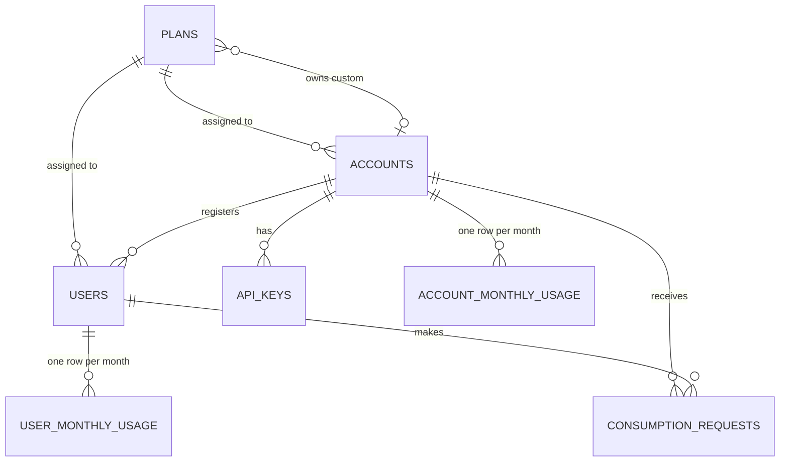

# Usage Metering and Quota Service

A backend service that other applications call **before** performing an action, to
check whether one of their users may consume some units, and to record the decision.

Each calling application has an **account** with an account plan (a shared allowance
for all its users), and each of its **users** has a user plan (an individual allowance).
Both plans apply to every request: a request is accepted only if every account and
user rule allows the **full** amount. A rejection consumes nothing and says which
rule blocked it and whether that rule belongs to the account or the user.

**Stack:** TypeScript · Node.js 24 · Express 5 · PostgreSQL 17 · Drizzle ORM · Docker Compose · Vitest

---

## Contents

1. [Quick start](#1-quick-start)
2. [Example walkthrough](#2-example-walkthrough)
3. [API reference](#3-api-reference)
4. [Predefined plans](#4-predefined-plans)
5. [Assumptions and decisions](#5-assumptions-and-decisions)
6. [Design](#6-design)
7. [Concurrency and correctness](#7-concurrency-and-correctness)
8. [Performance](#8-performance)
9. [Testing](#9-testing)
10. [Project structure](#10-project-structure)
11. [Configuration](#11-configuration)
12. [Known limitations and future work](#12-known-limitations-and-future-work)

---

## 1. Quick start

Requirements: Docker with Docker Compose.

```bash
docker compose up --build
```

This single command:

1. starts **PostgreSQL 17** (data kept in the `pgdata` volume),
2. builds and starts the **API** on http://localhost:3000, which applies the database
   migrations and seeds the predefined plans before it starts listening,
3. runs the **example client** once against the API, then exits.

```bash
docker compose logs client        # the example scenario's output
docker compose run --rm client    # run the scenario again (creates a fresh account)
docker compose down               # stop (data is kept)
docker compose down -v            # stop and delete the database
```

Creating accounts requires the operator key, sent as `x-admin-key`. It defaults to
`dev-admin-key-change-me-0123456789` for local use; set `ADMIN_API_KEY` in the
environment or a `.env` file to change it.

### Local development (without the API container)

Requires Node.js 22.18 or newer (24 recommended; the example client runs TypeScript directly).

```bash
cp .env.example .env
docker compose up -d --wait db    # database only; the api container would take port 3000
npm install
npm run dev                       # migrates, seeds, and reloads on change
npm test                          # 160 tests against the quota_test database
npm run demo                      # the example client against localhost:3000
```

---

## 2. Example walkthrough

The example client (`client/demo.ts`) plays the backend of a document-processing app.
Abridged output of `docker compose logs client`:

```text
2. Acme creates its own plans: a shared account plan and two user plans
   account plan  'Acme Shared': 100 units/month, max 30 per request (shared by everyone)
   user plan     'Acme Light' :  40 units/month, max 20 per request
   user plan     'Acme Heavy' : 500 units/month, max 30 per request

4. Accepted request: both allowances have room
   Ahmad asks for 20 units -> ACCEPTED
     user:    35/40 used, 5 left (max 20 per request)
     account: 35/100 used, 65 left (max 30 per request)

5. Rejected by the USER's rule: Ahmad's 40/month allowance is almost used up
   Ahmad asks for 10 units -> REJECTED by user rule "monthly_limit"

6. Rejected by the ACCOUNT's rule: Sara has 500/month, but the account only has 100 shared
   Sara asks for 10 units -> REJECTED by account rule "monthly_limit"
     user:    60/500 used, 440 left (max 30 per request)
     account: 95/100 used, 5 left (max 30 per request)

7. Retry with the same requestId (e.g. after a network timeout): no double counting
   Ahmad asks for 15 units -> ACCEPTED  (replayed: original decision)

8. Acme raises its shared plan to 300/month through the API: no code change, no redeploy
   Sara asks for 10 units -> ACCEPTED
     account: 105/300 used, 195 left (max 30 per request)
```

The same flow by hand:

```bash
# 1. Operator creates an account (the API key is returned only here)
curl -X POST localhost:3000/accounts \
  -H "x-admin-key: dev-admin-key-change-me-0123456789" -H "content-type: application/json" \
  -d '{"name": "Acme Docs"}'
# -> 201 { "account": { "id": "...", "plan": { "name": "Starter", ... } }, "apiKey": "uq_..." }

# 2. Register a user (Basic plan by default)
curl -X POST localhost:3000/users \
  -H "x-api-key: uq_..." -H "content-type: application/json" \
  -d '{"name": "Ahmad", "externalId": "emp-42"}'

# 3. Ask to consume units
curl -X POST localhost:3000/consumptions \
  -H "x-api-key: uq_..." -H "content-type: application/json" \
  -d '{"userId": "<user id>", "units": 10, "requestId": "doc-7781"}'
```

---

## 3. API reference

All requests and responses are JSON. Account-scoped endpoints require the account's
key in the **`x-api-key`** header; the key identifies the account, and every query is
restricted to that account's data.

### Endpoints

| Method | Path | Auth | Description |
|---|---|---|---|
| `GET` | `/health` | none | Liveness check |
| `POST` | `/accounts` | `x-admin-key` | Create an account and issue its API key |
| `GET` | `/account` | `x-api-key` | The calling account and the plan applied to it |
| `PATCH` | `/account/plan` | `x-api-key` | Move the account to another account plan |
| `GET` | `/account/usage?month=YYYY-MM` | `x-api-key` | The account's shared usage |
| `GET` | `/plans?scope=account\|user` | `x-api-key` | Predefined plans plus the account's own plans |
| `GET` | `/plans/:id` | `x-api-key` | One plan |
| `POST` | `/plans` | `x-api-key` | Create a custom plan |
| `PATCH` | `/plans/:id` | `x-api-key` | Update a custom plan (predefined plans are read-only) |
| `POST` | `/users` | `x-api-key` | Register a user |
| `GET` | `/users?limit=&cursor=&externalId=` | `x-api-key` | List users (newest first, paginated) |
| `GET` | `/users/:id` | `x-api-key` | One user and the plan applied to them |
| `PATCH` | `/users/:id/plan` | `x-api-key` | Move the user to another user plan |
| `GET` | `/users/:id/usage?month=YYYY-MM` | `x-api-key` | The user's individual usage |
| `POST` | `/consumptions` | `x-api-key` | **Consume units (the core operation)** |
| `GET` | `/consumptions?limit=&cursor=&userId=&status=&month=` | `x-api-key` | Decision log (newest first, paginated) |

### `POST /consumptions`

Request:

```json
{ "userId": "8f6c…", "units": 10, "requestId": "doc-7781" }
```

- `units`: positive whole number.
- `requestId`: chosen by the caller, unique per operation; **reuse it when retrying**.

Response (`200` for both outcomes; a rejection is a decision, not an error):

```json
{
  "requestId": "doc-7781",
  "userId": "8f6c…",
  "units": 10,
  "accepted": false,
  "rejection": {
    "rule": "monthly_limit",
    "scope": "account",
    "message": "Not enough remaining units in the account's monthly allowance"
  },
  "month": "2026-10",
  "account": { "planId": "…", "monthlyLimit": 100, "maxUnitsPerRequest": 30, "used": 95, "remaining": 5 },
  "user":    { "planId": "…", "monthlyLimit": 500, "maxUnitsPerRequest": 30, "used": 60, "remaining": 440 },
  "decidedAt": "2026-10-19T18:35:44.786Z"
}
```

- `rejection` is `null` when accepted. `rule` is `max_units_per_request` or `monthly_limit`;
  `scope` is `account` or `user`.
- `account` / `user` show the limits the decision was made under and the usage **after** it.
- Retrying a `requestId` with the same `userId` and `units` returns the original body
  unchanged, with the header **`Idempotent-Replayed: true`**, and counts nothing.

### Usage

```json
GET /users/:id/usage            -> { "month": "2026-10", "used": 35, "plan": { … }, "remaining": 5 }
GET /users/:id/usage?month=2026-09 -> { "month": "2026-09", "used": 15, "plan": null, "remaining": null }
```

### Pagination

List endpoints return `{ "items": [...], "nextCursor": "…" | null }`. Pass `cursor`
back to get the next page; `limit` is 1–100 (default 20).

### Errors

Every error has the same shape:

```json
{ "error": { "code": "USER_NOT_FOUND", "message": "User not found", "details": [] } }
```

`code` is stable and meant for programs; `message` is for people. `details` appears
on validation errors as a list of `{ "path", "message" }`.

| Status | Codes |
|---|---|
| 400 | `VALIDATION_ERROR`, `INVALID_JSON`, `PLAN_SCOPE_MISMATCH` |
| 401 | `MISSING_API_KEY`, `INVALID_API_KEY`, `MISSING_ADMIN_KEY`, `INVALID_ADMIN_KEY` |
| 403 | `PREDEFINED_PLAN_READ_ONLY` |
| 404 | `ACCOUNT_NOT_FOUND`, `PLAN_NOT_FOUND`, `USER_NOT_FOUND`, `ROUTE_NOT_FOUND` |
| 409 | `REQUEST_ID_REUSED`, `EXTERNAL_ID_TAKEN` |
| 413 | `PAYLOAD_TOO_LARGE` (bodies over 100 kB) |
| 503 | `LOCK_TIMEOUT`, `DATABASE_BUSY`, `DATABASE_UNAVAILABLE` (with `Retry-After`; safe to retry) |
| 500 | `INTERNAL_ERROR` (details are logged, never returned) |

---

## 4. Predefined plans

Seeded on startup with fixed ids so clients can reference them. Read-only through the API.

| Plan | Scope | Monthly allowance | Max per request | Id |
|---|---|---:|---:|---|
| **Starter** | account | 10,000 | 100 | `00000000-0000-4000-8000-000000000001` |
| **Pro** | account | 100,000 | 1,000 | `00000000-0000-4000-8000-000000000002` |
| **Basic** | user | 500 | 50 | `00000000-0000-4000-8000-000000000003` |
| **Premium** | user | 5,000 | 200 | `00000000-0000-4000-8000-000000000004` |

New accounts start on **Starter** and new users on **Basic** unless a plan is given.
Account limits are about 20× a user's, so one account comfortably serves a small team
while still being able to run out before any single user does.

---

## 5. Assumptions and decisions

The brief leaves some behaviour open. These are the choices made, applied consistently.

**Units and months**
- The unit is one resource ("processing credits"); every amount is a positive whole number.
- Usage is counted per **calendar month in UTC**, using the server's clock. A new month
  starts from zero; previous months stay stored and queryable.
- For a **past** month, usage endpoints return `used` only (`plan` and `remaining` are
  `null`): limits may have changed since, so a "remaining" figure would mislead.
  A future month is rejected (400).

**Plans**
- Each plan has two rules: a **monthly allowance** and a **maximum units per request**.
- `maxUnitsPerRequest` may not exceed `monthlyLimit` (400): such a limit could never be used.
- A plan's scope (`account` or `user`) is fixed at creation and checked on every
  assignment, so a user plan can never be given to an account or vice versa.
- Predefined plans are read-only (403). An account sees and uses predefined plans and
  its own custom plans only; another account's plan is reported as **not found** (404),
  so its existence is not revealed.
- **Editing a plan takes effect immediately** for every account or user on it, for new
  requests. Plans are data, not code: no redeploy.
- **Changing or editing a plan never resets usage.** If a limit is lowered below what
  was already used, `remaining` shows 0 and new requests are rejected until the limit
  rises or the month ends.
- Accounts may switch their own plan freely (there is no billing in scope).
- Plans and users cannot be deleted.

**Consumption**
- The full amount is accepted or nothing is; there are no partial grants.
- When several rules fail, the first in this fixed order is reported:
  user per-request → account per-request → user monthly → account monthly.
  Per-request limits come first because no remaining allowance can make such a request
  pass; the caller must split it.
- Accepted and rejected are both **200** with `accepted: true|false`. Errors (bad input,
  unknown user, bad key) use 4xx and are not recorded as decisions.
- **Idempotency:** `requestId` is unique per account (two accounts may use the same value).
  Same `requestId` + same `userId` and `units` → the original decision, even if a retry
  would now be decided differently (for example after a plan upgrade); a new attempt needs a
  new `requestId`. Same `requestId` with different data → 409 `REQUEST_ID_REUSED`.
- A request for a user of another account is a 404 and takes no locks.

**Access**
- `POST /accounts` is an operator action protected by `ADMIN_API_KEY` (`x-admin-key`).
- API keys are returned once at creation; only their SHA-256 hash is stored. Unknown and
  revoked keys get the same 401, so a caller cannot tell them apart.
- Users have no login: the calling application authenticates its own users and the
  service trusts it through the account's key. `externalId` (optional) lets the caller
  store its own identifier for a user; it is unique within an account.
- A malformed id in a URL (not a UUID) is a 400; a well-formed id that does not exist
  or belongs to another account is a 404.

---

## 6. Design

### Data model

Seven tables. Full rationale for every column and constraint:
[docs/database-design.md](docs/database-design.md) (Arabic).



| Table | Holds |
|---|---|
| `plans` | Predefined (`owner_account_id IS NULL`) and custom plans: scope, monthly limit, max per request |
| `accounts` | Calling applications and their current plan |
| `api_keys` | SHA-256 hashes of account keys (supports revocation and rotation) |
| `users` | Users of each account and their current plan |
| `account_monthly_usage` | **One row per account per month** with the total accepted units |
| `user_monthly_usage` | **One row per user per month** with the total accepted units |
| `consumption_requests` | Every decision: the idempotency key, the outcome and reason, and a **snapshot** of the limits and usage it was based on |

Key choices:

- **Store what was used, compute what remains.** `used` is a fact; `remaining` depends on
  the plan applied now, which can change. Storing `remaining` would mean rewriting rows on
  every plan edit.
- **Monthly counters instead of `SUM` over the log.** Reading one row is constant-time, and,
  more importantly, it gives each account and each user **one row to lock**.
- **The log keeps a snapshot.** Each decision stores the plan ids, limits and prior usage it
  saw, so it stays explainable after plans change, and a replay returns the exact original response.
- **The database enforces the rules it can.** Composite foreign keys make it impossible to
  assign a plan of the wrong scope, or to record a request for a user of another account.
  `CHECK` constraints reject non-positive units, negative usage, non-first-of-month dates,
  a rejection without a reason, and a decision without its snapshot.

### Architecture

Feature modules with layers inside (routes → service → database):

- **Routes** validate input with zod and call a service; they never query the database.
- **Services** hold the business logic and receive the `accountId` from the API key, never
  from the request body, so isolation between accounts is explicit in every function.
- **`decide()`** is a pure function with no I/O: the four rules in one place, unit-tested directly.
- **`consume.repository.ts`** holds the locking queries; every function requires the
  transaction handle, so TypeScript prevents running them outside the transaction.
- **One error handler** turns every thrown error into the JSON error shape; routes contain no
  `try/catch`.

More: [docs/architecture.md](docs/architecture.md) (Arabic).

---

## 7. Concurrency and correctness

### The problem

An account has 10 units left and two different requests for 10 arrive at the same moment.
If both read "10 left" before either writes, both are accepted and the account is over its limit.

### The consume transaction

```mermaid
sequenceDiagram
  participant C as Caller
  participant S as Service
  participant DB as PostgreSQL
  C->>S: POST /consumptions {userId, units, requestId}
  S->>DB: check the user belongs to the account (no lock)
  S->>DB: BEGIN; SET LOCAL lock_timeout
  S->>DB: INSERT request (pending) ON CONFLICT DO NOTHING
  Note over S,DB: no row back = requestId already used → return original decision or 409
  S->>DB: INSERT month rows ON CONFLICT DO NOTHING
  S->>DB: SELECT account usage FOR UPDATE (lock 1)
  S->>DB: SELECT user usage FOR UPDATE (lock 2)
  S->>DB: read both current plans
  S->>S: decide(units, account, user)
  S->>DB: if accepted: used_units = used_units + units (both rows)
  S->>DB: UPDATE request: decision + reason + snapshot
  S->>DB: COMMIT (locks released)
  S-->>C: 200 {accepted, rejection, account, user}
```

- **Row locks (`SELECT … FOR UPDATE`)** serialise requests that touch the same account; a
  competing transaction waits, then reads the committed value. Different accounts lock
  different rows and do not wait for each other.
- **Fixed lock order** (account row, then user row) everywhere, so two consumptions can never deadlock.
- **Month rows are created before locking**, because `FOR UPDATE` cannot lock a row that does not exist.
- **Plans are read after the locks**, so a decision always uses the latest committed plan, as
  one complete version: never half of an edit.
- **Idempotency through the unique index.** The request row is inserted first. A concurrent
  duplicate blocks on the `(account_id, request_id)` unique index until the first transaction
  ends, then sees the stored decision. Exactly one of them counts.
- **All or nothing.** Any error rolls back everything, the reservation included, so a retry
  with the same `requestId` is always safe.
- **Bounded waiting.** `lock_timeout` (2 s by default) turns a long queue into a retryable 503
  instead of an indefinitely held connection.
- Increments are done in SQL (`used_units + n`), never computed in JavaScript.

### Proof that the locks matter

The concurrency tests fire 200 simultaneous 1-unit requests at an account with a limit of 100.
With the locks, exactly 100 are accepted, every time. As an experiment, the two `FOR UPDATE`
clauses were removed temporarily:

```text
× accepts exactly 100 of 200 simultaneous 1-unit requests ...
  AssertionError: expected [ …(103) ] to have a length of 100 but got 103
× enforces a user's limit under concurrency too
  AssertionError: expected [ …(52) ] to have a length of 50 but got 52
```

Without them, 103 requests got through a limit of 100.

### Invariants checked after every concurrency test

1. Each account counter equals the sum of its accepted requests that month.
2. Each user counter equals the sum of their accepted requests that month.
3. Each account counter equals the sum of its users' counters.
4. Every accepted request fits the limits recorded in its own snapshot.
5. No request is left `pending`.

---

## 8. Performance

- Every consumption touches a fixed number of rows through primary keys or unique indexes, so
  its cost does not grow with history. The log is never summed at request time.
- Transactions are short and contain no external calls, so locks are held for milliseconds.
- History and user lists use **keyset (cursor) pagination** on
  `(created_at DESC, id DESC)` indexes, so deep pages stay as fast as the first one.
  Cursors keep timestamps at microsecond precision so no row is skipped or repeated.
- **Trade-off: the account row is a hot spot.** Requests for the same account are serialised on
  its usage row, so one account's throughput is bounded by roughly 1 ÷ lock-hold time. This is
  deliberate: the alternative is exceeding limits. Different accounts proceed in parallel.
- **Pool protection.** Requests waiting on a lock still hold a pool connection; without limits, one
  very busy account could exhaust the pool and slow everyone. `lock_timeout` and the pool's
  `connectionTimeoutMillis` bound both waits and return a retryable 503.
- The pool size is configurable (`DB_POOL_MAX`, default 20). A larger pool does not speed up a
  single account (its requests are serialised anyway) and can slow PostgreSQL down through contention.

A load-testing run (hot account vs. many accounts, p95 latency, throughput) was planned but not
completed in the time available; see [future work](#12-known-limitations-and-future-work).

---

## 9. Testing

```bash
docker compose up -d --wait db
npm test
```

**160 tests** (Vitest + Supertest) in 10 files. Integration tests run against a real PostgreSQL
database (`quota_test`, created automatically), not mocks, because locks, constraints and
transactions are what they need to verify. Each test starts from a truncated, re-seeded database.

| File | Covers |
|---|---|
| `unit/decide.test.ts` | Every rule, exact boundaries, the order of reported reasons, UTC month bucketing |
| `unit/errorHandler.test.ts` | Error shape, async errors, invalid JSON, oversized bodies, DB timeouts → 503, no leaked internals |
| `unit/apiKey.test.ts` | Key format, hashing, constant-time comparison |
| `integration/auth.test.ts` | Missing, unknown, revoked, oversized keys; only hashes stored; admin key |
| `integration/accounts.test.ts` | Account creation, default plan, plan scope, isolation |
| `integration/plans.test.ts` | Custom plans, read-only predefined plans, limit consistency, edits applying to all users of a plan |
| `integration/users.test.ts` | Users, plan assignment, `externalId` uniqueness, pagination, isolation |
| `integration/consumptions.test.ts` | Accept/reject for every rule, no consumption on rejection, plan changes without reset, new month, idempotency, 409, validation |
| `integration/concurrency.test.ts` | 200 concurrent requests on a limit of 100 → exactly 100; user limit under concurrency; the same `requestId` 20× at once → counted once; plan edited during 100 concurrent requests |
| `integration/usage-and-history.test.ts` | Usage for current, past and future months; history filters and pagination |

Other checks: `npm run typecheck` (strict TypeScript), and the full stack was verified from a
clean state (`docker compose down -v && docker compose up --build`) including restart persistence
and graceful shutdown on `SIGTERM`.

---

## 10. Project structure

```text
src/
  app.ts, server.ts, config.ts      Express app, startup (migrate + seed + listen), validated env
  db/                               schema.ts (all tables), client.ts (pool), migrate, seed, errors
  middleware/                       apiKeyAuth, adminAuth, errorHandler
  shared/                           errors, validation, apiKey, month, pagination
  modules/
    accounts/  plans/  users/  usage/
    consumptions/                   decide.ts, consume.repository.ts, consume.service.ts, routes
drizzle/                            generated SQL migrations
tests/                              setup/, helpers/ (factories, invariants), unit/, integration/
client/demo.ts                      example client (no dependencies)
docs/                               database design, architecture, plan (Arabic)
Dockerfile, docker-compose.yml
```

---

## 11. Configuration

| Variable | Default | Purpose |
|---|---|---|
| `DATABASE_URL` | (required) | PostgreSQL connection string |
| `ADMIN_API_KEY` | (required, ≥ 16 chars) | Operator key for `POST /accounts` |
| `PORT` | `3000` | HTTP port |
| `DB_POOL_MAX` | `20` | Connections in the pool |
| `DB_CONNECTION_TIMEOUT_MS` | `5000` | Max wait for a free pool connection before a 503 |
| `CONSUME_LOCK_TIMEOUT_MS` | `2000` | Max wait for a usage-row lock before a 503 |
| `RUN_MIGRATIONS_ON_START` | `true` | Apply migrations and seed predefined plans on startup |
| `TEST_DATABASE_URL` | `…/quota_test` | Database used by the test suite |

The service refuses to start with missing or invalid configuration. See `.env.example`.

---

## 12. Known limitations and future work

- **Load testing.** Measure throughput and p95 latency for one hot account versus many accounts,
  and for a mixed load, across several pool sizes, to document the hot-row trade-off with numbers.
- **Per-account concurrency limit.** Cap how many of one account's requests wait in the database at
  once, so a flood from one account cannot occupy the whole pool.
- **Key management endpoints.** The schema supports several keys per account and revocation;
  endpoints to rotate and revoke keys are not exposed yet.
- **Migrations as a separate step.** Running them on startup suits a single instance; with several
  API replicas they should run once, before the rollout.
- **Retention.** `consumption_requests` grows with every decision; partitioning by month and an
  archival policy would keep it manageable at scale.
- **Rate limiting and observability.** Request rate limits per key, structured logs and metrics.

---

Planning and design documents (Arabic): [database design](docs/database-design.md) ·
[architecture](docs/architecture.md) · [implementation plan](docs/plan.md)
