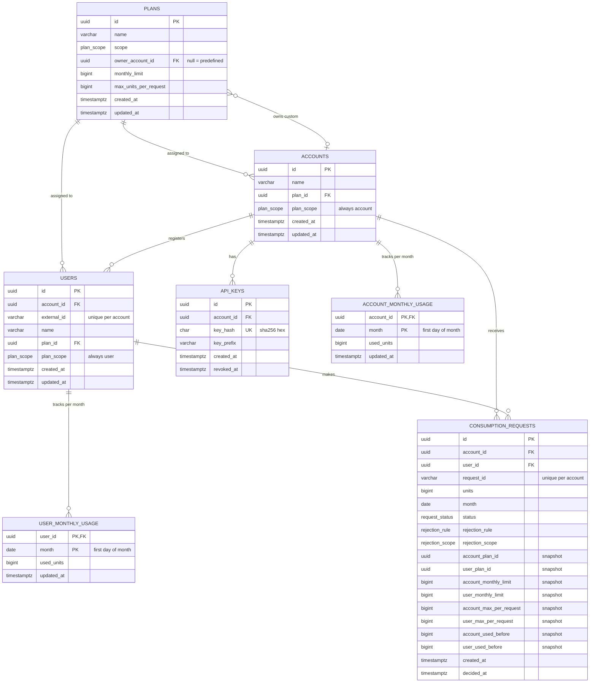

# تصميم قاعدة البيانات: Usage Metering and Quota Service

> الحالة: **معتمد ومُنفَّذ** في `src/db/schema.ts` → `drizzle/0000_init.sql`.
> الـ Stack: TypeScript + Express + PostgreSQL + Drizzle ORM + Docker Compose.

---

## 1. نظرة عامة

قاعدة البيانات تتكون من **7 جداول** و **4 أنواع enum**، وتنقسم لمجموعتين:

| المجموعة | الجداول | تجاوب على |
|---|---|---|
| **التعريف**: مين وشو الحدود | `plans`, `accounts`, `api_keys`, `users` | مين الشركة؟ مين المستخدم؟ شو حدودهم؟ |
| **الاستهلاك**: شو صار ووين وصلنا | `account_monthly_usage`, `user_monthly_usage`, `consumption_requests` | كم استهلكوا؟ شو القرار؟ وليش؟ |

### المبادئ العامة

1. **خزّن الحقائق واحسب المشتقّات.** نخزّن `used` لأنه حقيقة، ونحسب `remaining` لأنه يعتمد على الخطة الحالية.
2. **الداتابيس خط الدفاع الأخير.** كل قاعدة يمكن فرضها بقيد تُفرض بقيد، والكود يفحص أيضاً لكن لإعطاء رسائل خطأ واضحة.
3. **صف واحد لكل شيء نحتاج نقفله.** العدّادات الشهرية موجودة أصلاً حتى يكون في صف نقفله.
4. **التاريخ لا يتغيّر.** كل طلب يحمل نسخة من المعطيات وقت القرار، ولا يتأثر بتغيير الخطط لاحقاً.

### فلسفة "كشف الحساب والرصيد"

| | كشف الحساب | الرصيد |
|---|---|---|
| الجدول | `consumption_requests` | `account_monthly_usage` و `user_monthly_usage` |
| شو هو؟ | كل طلب صار، مقبول أو مرفوض | رقم واحد لكل شهر: المجموع المقبول |
| يتغيّر؟ | لا، نضيف فقط | يزيد مع كل طلب مقبول |
| يُستخدم لـ | التاريخ، الشرح، منع التكرار | القرار السريع والقفل |

**لا نجمع `consumption_requests` وقت الاستهلاك أبداً.** نقرأ العدّاد الجاهز ونقفله.

---

## 2. مخطط العلاقات (ERD)



---

## 3. الأنواع (Enums)

| الاسم | القيم | ملاحظة |
|---|---|---|
| `plan_scope` | `account`, `user` | لمين الخطة |
| `request_status` | `pending`, `accepted`, `rejected` | `pending` تظهر داخل الـ transaction فقط ولا تُثبَّت أبداً |
| `rejection_rule` | `max_units_per_request`, `monthly_limit` | أي قاعدة منعت |
| `rejection_scope` | `account`, `user` | لمين القاعدة |

---

## 4. الجداول بالتفصيل

### 4.1 `plans`: الخطط

**وظيفته:** يخزّن قواعد الاستهلاك، وهي الحد الشهري والحد الأقصى للطلب الواحد.

| العمود | النوع | القيود | السبب |
|---|---|---|---|
| `id` | `uuid` | PK, `default gen_random_uuid()` | معرّف لا يُخمَّن |
| `name` | `varchar(100)` | NOT NULL | للعرض فقط، فشركتان ممكن تستخدمان نفس الاسم |
| `scope` | `plan_scope` | NOT NULL | يمنع إسناد خطة مستخدم لشركة أو العكس |
| `owner_account_id` | `uuid` | FK → accounts, NULL | **NULL = خطة جاهزة**، وقيمة = خطة خاصة بالشركة |
| `monthly_limit` | `bigint` | NOT NULL, `CHECK > 0` | القاعدة الأولى |
| `max_units_per_request` | `bigint` | NOT NULL, `CHECK > 0` | القاعدة الثانية |
| `created_at` / `updated_at` | `timestamptz` | NOT NULL, `default now()` | تتبع |

- `UNIQUE (id, scope)`: موجود فقط لتمكين الـ FK المركّبة من `accounts` و `users`.
- Index على `owner_account_id`: لعرض خطط شركة معيّنة.

**قرارات التصميم:**
- **جدول واحد للجاهزة والخاصة:** الخطة خطة، والفرق الوحيد هو المالك. هذا يخلي `plan_id` في `accounts` و `users` FK عادية، وكود الاستهلاك يقرأ الحدود بطريقة واحدة.
- **لا يوجد عمود `is_predefined`:** المعلومة موجودة في `owner_account_id IS NULL`، وعمود إضافي ممكن يتناقض معها.
- **الحدود أعمدة وليست جدول `plan_rules`:** القواعد اثنتان بالضبط، والأعمدة تسمح بـ `NOT NULL` و `CHECK` وقراءة بدون JOIN.
- **`bigint`:** الاستهلاك التراكمي للشركات الكبيرة ممكن يقترب من حد `integer` (2.1 مليار). وفي Drizzle نستخدم `mode: "number"`.
- **الخطط الجاهزة للقراءة فقط:** الكود يمنع تعديل أي خطة `owner_account_id` فيها NULL.

---

### 4.2 `accounts`: الشركات / التطبيقات

**وظيفته:** يمثّل كل جهة تستخدم الخدمة، سواء تطبيقاً أو شركة. سمّيناه `account` لأن المطلوب يستخدم هذا المصطلح، ولأن شركة واحدة ممكن يكون عندها أكثر من حساب، مثلاً حساب لكل تطبيق.

| العمود | النوع | القيود | السبب |
|---|---|---|---|
| `id` | `uuid` | PK | |
| `name` | `varchar(200)` | NOT NULL | للعرض |
| `plan_id` | `uuid` | NOT NULL | خطة الشركة الحالية، وهي خطة واحدة فقط |
| `plan_scope` | `plan_scope` | NOT NULL, `default 'account'`, `CHECK (= 'account')` | لتمكين الـ FK المركّبة |
| `created_at` / `updated_at` | `timestamptz` | NOT NULL | |

- FK مركّبة: `(plan_id, plan_scope) → plans(id, scope)`.

**حيلة `plan_scope` الثابتة:** FK عادية `plan_id → plans.id` تتحقق فقط أن الخطة موجودة. الـ FK المركّبة تتحقق أن الخطة موجودة **ونوعها `account`**، فالداتابيس نفسها ترفض إسناد خطة مستخدم لشركة.

**ما لا تفرضه الداتابيس:** أن الخطة الخاصة تتبع **نفس** الشركة. هذا الفحص في الكود:
`owner_account_id IS NULL OR owner_account_id = :accountId`

---

### 4.3 `api_keys`: مفاتيح الوصول

**وظيفته:** يربط المفتاح القادم في الهيدر بالشركة صاحبته.

| العمود | النوع | القيود | السبب |
|---|---|---|---|
| `id` | `uuid` | PK | |
| `account_id` | `uuid` | NOT NULL, FK → accounts | |
| `key_hash` | `char(64)` | NOT NULL, UNIQUE | SHA-256 hex. **المفتاح نفسه لا يُخزَّن أبداً** |
| `key_prefix` | `varchar(12)` | NOT NULL | أول أحرف المفتاح، للعرض والتمييز فقط |
| `created_at` | `timestamptz` | NOT NULL | |
| `revoked_at` | `timestamptz` | NULL | NULL = فعّال. التاريخ يعطي "هل أُلغي" و"متى" معاً |

**قرارات التصميم:**
- **جدول منفصل وليس عموداً في `accounts`:** يسمح بتدوير المفاتيح ووجود مفتاحين فعّالين خلال فترة انتقالية.
- **SHA-256 وليس bcrypt:** المفتاح عشوائي طويل (32 بايت)، فلا يحتاج hash بطيئاً. و SHA-256 ثابت فيسمح بالبحث المباشر `WHERE key_hash = ?` بالـ index، وهذا مهم لأن البحث يحصل مع كل طلب.
- المفتاح يظهر **مرة واحدة فقط** عند الإنشاء.

---

### 4.4 `users`: المستخدمون

**وظيفته:** مستخدمو كل شركة. **ليس نظام تسجيل دخول**، فهوية المستخدم يتحقق منها تطبيق الشركة.

| العمود | النوع | القيود | السبب |
|---|---|---|---|
| `id` | `uuid` | PK | معرّفنا الداخلي |
| `account_id` | `uuid` | NOT NULL, FK → accounts | أساس العزل بين الشركات |
| `external_id` | `varchar(255)` | NULL | معرّف المستخدم في تطبيق الشركة (اختياري) |
| `name` | `varchar(200)` | NOT NULL | للعرض |
| `plan_id` | `uuid` | NOT NULL | خطة المستخدم الحالية |
| `plan_scope` | `plan_scope` | NOT NULL, `default 'user'`, `CHECK (= 'user')` | لتمكين الـ FK المركّبة |
| `created_at` / `updated_at` | `timestamptz` | NOT NULL | |

- FK مركّبة: `(plan_id, plan_scope) → plans(id, scope)`.
- `UNIQUE (account_id, external_id)`: فريد ضمن الشركة. وقيم NULL المتعددة لا تتعارض.
- `UNIQUE (account_id, id)`: لتمكين FK مركّبة من `consumption_requests`.
- Index على `plan_id`: لمعرفة المستخدمين على خطة معيّنة.

**لا يوجد password أو email**، لأن تسجيل دخول المستخدمين خارج المطلوب.

---

### 4.5 `account_monthly_usage`: استهلاك الشركة الشهري

**وظيفته:** **صف واحد لكل شركة لكل شهر**، فيه مجموع الوحدات المقبولة.

| العمود | النوع | القيود | السبب |
|---|---|---|---|
| `account_id` | `uuid` | PK, FK → accounts | |
| `month` | `date` | PK, `CHECK` أول يوم بالشهر | |
| `used_units` | `bigint` | NOT NULL, `default 0`, `CHECK >= 0` | المجموع المقبول |
| `updated_at` | `timestamptz` | NOT NULL | آخر نشاط |

```
account_id | month       | used_units
-----------+-------------+-----------
acc_A      | 2026-09-01  | 870
acc_A      | 2026-10-01  | 410
acc_B      | 2026-10-01  | 12
```

**قرارات التصميم:**
- **نخزّن المجموع ولا نحسبه بـ `SUM`:** أولاً للسرعة، صف واحد بدل آلاف. وثانياً، وهو الأهم، لأنه **يعطينا صفاً واحداً نقفله**. مع `SUM` ما في شيء نقفله، فطلبان متزامنان يتجاوزان الحد.
- **لا نخزّن `remaining`:** المتبقي يعتمد على الخطة الحالية اللي ممكن تتغيّر. نحسبه هكذا: `max(0, plan.monthly_limit − used_units)`.
- **`month` من نوع `date` وليس نصاً:** يدعم المقارنة والترتيب، والـ CHECK يضمن صيغة واحدة.
- **PK مركّب بدون `id`:** الصف معرَّف طبيعياً بالشركة والشهر، والـ PK يعمل كـ index ويمنع التكرار ويسمح بـ `ON CONFLICT DO NOTHING`.
- **إنشاء عند الحاجة (lazy):** الصف يُنشأ مع أول طلب في الشهر. لا يوجد cron job، ولا تصفير، والأشهر السابقة تبقى محفوظة.
- **الصف "الساخن":** كل طلبات الشركة تقفل نفس الصف فتصطف. هذا ثمن مقبول مقابل صحة الحدود، والشركات المختلفة لا تنتظر بعضها.

---

### 4.6 `user_monthly_usage`: استهلاك المستخدم الشهري

**وظيفته:** **صف واحد لكل مستخدم لكل شهر**، بنفس فلسفة الجدول السابق.

| العمود | النوع | القيود |
|---|---|---|
| `user_id` | `uuid` | PK, FK → users |
| `month` | `date` | PK, `CHECK` أول يوم بالشهر |
| `used_units` | `bigint` | NOT NULL, `default 0`, `CHECK >= 0` |
| `updated_at` | `timestamptz` | NOT NULL |

**قرارات التصميم:**
- **جدولان وليس جدولاً موحّداً `(subject_type, subject_id)`:** الجدول الموحّد لا يسمح بـ FK حقيقية.
- **عدّاد الشركة مستقل عن مجموع المستخدمين:** حتى يكون هناك صف واحد يمثّل الشركة كاملة للقفل.
- **الخطة المشتركة لا تعني عدّاداً مشتركاً:** العدّاد مربوط بـ `user_id`، والخطة تعطي الحد فقط.

**علاقة الجدولين:** كل طلب مقبول يزيد الصفّين بنفس الكمية، وهي نفس الوحدات محسوبة على مستويين.

---

### 4.7 `consumption_requests`: سجل الطلبات

**وظيفته:** ثلاث وظائف:
1. **Idempotency:** منع تنفيذ نفس الطلب مرتين.
2. **السجل:** كل قرار، مقبولاً كان أو مرفوضاً.
3. **الشرح:** ليش انرفض، مع المعطيات وقت القرار.

| العمود | النوع | القيود | السبب |
|---|---|---|---|
| `id` | `uuid` | PK | للـ pagination |
| `account_id` | `uuid` | NOT NULL | |
| `user_id` | `uuid` | NOT NULL | |
| `request_id` | `varchar(255)` | NOT NULL | بصمة العملية من الشركة |
| `units` | `bigint` | NOT NULL, `CHECK > 0` | |
| `month` | `date` | NOT NULL, `CHECK` أول يوم | الشهر اللي انحسب عليه الطلب (يُحدَّد مرة واحدة) |
| `status` | `request_status` | NOT NULL | |
| `rejection_rule` | `rejection_rule` | NULL | |
| `rejection_scope` | `rejection_scope` | NULL | |
| `account_plan_id` | `uuid` | NULL | نسخة: ليست FK لأنها سجل تاريخي |
| `user_plan_id` | `uuid` | NULL | نسخة |
| `account_monthly_limit` | `bigint` | NULL | نسخة |
| `user_monthly_limit` | `bigint` | NULL | نسخة |
| `account_max_per_request` | `bigint` | NULL | نسخة |
| `user_max_per_request` | `bigint` | NULL | نسخة |
| `account_used_before` | `bigint` | NULL | نسخة |
| `user_used_before` | `bigint` | NULL | نسخة |
| `created_at` | `timestamptz` | NOT NULL | |
| `decided_at` | `timestamptz` | NULL | |

**القيود:**
- `UNIQUE (account_id, request_id)`: مفتاح الـ idempotency. كل شركة لها فضاء معرّفات خاص بها.
- FK مركّبة `(account_id, user_id) → users(account_id, id)`: المستخدم تابع لنفس الشركة.
- CHECK للتناسق: المرفوض لازم معه `rule` و `scope`، وغير المرفوض لازم بدونهما.
- CHECK للنسخة: كل طلب غير `pending` لازم يكون فيه `decided_at` والنسخة كاملة.

**Indexes:**
- `(account_id, created_at DESC, id DESC)`: لسجل الشركة مع cursor pagination.
- `(user_id, created_at DESC, id DESC)`: لسجل مستخدم معيّن.

**حالات الـ Idempotency:**

| الحالة | النتيجة |
|---|---|
| `request_id` جديد | ننفّذ ونسجّل |
| مكرر ونفس `userId` و `units` | نرجّع القرار الأصلي حرفياً، بدون خصم |
| مكرر ببيانات مختلفة | `409 Conflict` |
| مكرر والأصلي مرفوض | نفس الرفض، حتى لو صار الرصيد كافياً. المحاولة الجديدة تحتاج معرّفاً جديداً |
| نسختان بنفس اللحظة | الثانية تنتظر على القيد الفريد حتى تثبت الأولى، ثم ترجع نتيجتها |

**ما لا يُسجَّل:** الأخطاء قبل القرار، يعني 401 (مفتاح) و 400 (بيانات غير صالحة) و 404 (مستخدم غير موجود أو لشركة أخرى). **الرفض** قرار عن طلب صالح فيُسجَّل، أما **الخطأ** فطلب غير صالح فلا يُسجَّل.

**ليش النسخة (snapshot)؟** القرار اتُّخذ في لحظة معيّنة بمعطيات معيّنة. لو تغيّرت الخطة لاحقاً، النسخة تبقي القرار مفهوماً ومبرّراً، وتسمح بإعادة نفس الاستجابة حرفياً عند تكرار الطلب.

---

## 5. ملخص الحماية بالقيود

| الخطر | القيد |
|---|---|
| إسناد خطة مستخدم لشركة أو العكس | FK مركّبة `(plan_id, plan_scope) → plans(id, scope)` |
| طلب استهلاك لمستخدم من شركة أخرى | FK مركّبة `(account_id, user_id) → users(account_id, id)` |
| خصم نفس الطلب مرتين | `UNIQUE (account_id, request_id)` |
| وحدات صفر أو سالبة | `CHECK units > 0` |
| استهلاك سالب | `CHECK used_units >= 0` |
| صفّان لنفس الشهر | PK `(account_id, month)` و `(user_id, month)` |
| شهر بصيغة خاطئة | `CHECK (month = date_trunc('month', month))` |
| رفض بدون سبب أو قبول مع سبب | CHECK التناسق |
| استخدام خطة خاصة بشركة أخرى | **في الكود** (لا يمكن فرضه بقيد بسيط) |

---

## 6. فلو الاستهلاك والأقفال

**كل الأقفال عند PostgreSQL**، والكود يطلبها فقط عبر SQL. لا يوجد أي قفل في ذاكرة التطبيق.

```
خارج الـ transaction (بدون أقفال):
  1. التحقق من المفتاح          → 401
  2. التحقق من البيانات (zod)    → 400
  3. المستخدم تابع للشركة؟       → 404

BEGIN
  4. تحديد الشهر (UTC) في الكود
  5. INSERT consumption_requests (pending) ON CONFLICT DO NOTHING RETURNING id
       🔒 قفل ضمني على الصف الجديد
       لا يوجد id → فرع الإعادة: نرجّع القرار الأصلي أو 409
  6. INSERT صفوف الشهر (شركة + مستخدم) ON CONFLICT DO NOTHING
  7. SELECT account_monthly_usage FOR UPDATE      🔒 قفل صريح (1)
  8. SELECT user_monthly_usage    FOR UPDATE      🔒 قفل صريح (2)
  9. قراءة الخطط الحالية (بدون قفل)
 10. decide(): pure function في الكود
       ترتيب الفحص الثابت:
         user.max_units_per_request
         account.max_units_per_request
         user.monthly_limit
         account.monthly_limit
 11. إذا قُبل: UPDATE العدّادين  used_units = used_units + units
 12. UPDATE consumption_requests: الحالة + السبب + النسخة
COMMIT  🔓 كل الأقفال تتحرر
```

| القفل | النوع | مين يطلبه |
|---|---|---|
| صف `consumption_requests` الجديد | ضمني | الداتابيس عند `INSERT` |
| صف `account_monthly_usage` | صريح | `.for("update")` في Drizzle |
| صف `user_monthly_usage` | صريح | `.for("update")` في Drizzle |
| الخطط، المستخدم، المفتاح | بدون قفل | قراءة عادية (MVCC) |

**قواعد مهمة:**
- **ترتيب القفل ثابت: الشركة ثم المستخدم**، لمنع الـ deadlock.
- **صف الشهر يُنشأ قبل القفل**، لأن `FOR UPDATE` لا يقفل صفاً غير موجود.
- **الخطط تُقرأ بعد أخذ الأقفال**، فتعكس آخر تعديل ثابت.
- **كل استعلام داخل الـ transaction يستخدم `tx` وليس `db`.**
- **لا اتصالات خارجية داخل الـ transaction**، حتى تبقى الأقفال قصيرة.
- **الزيادة تتم في SQL** (`used_units + units`) وليست قيمة محسوبة في الكود.

---

## 7. الثوابت (Invariants) للاختبار

```sql
-- عدّاد الشركة = مجموع طلباتها المقبولة في الشهر
SELECT a.account_id, a.month, a.used_units,
       COALESCE(SUM(r.units) FILTER (WHERE r.status = 'accepted'), 0) AS from_log
FROM account_monthly_usage a
LEFT JOIN consumption_requests r
  ON r.account_id = a.account_id AND r.month = a.month
GROUP BY a.account_id, a.month, a.used_units
HAVING a.used_units <> COALESCE(SUM(r.units) FILTER (WHERE r.status = 'accepted'), 0);
-- المتوقع: صفر صفوف

-- عدّاد الشركة = مجموع عدّادات مستخدميها في نفس الشهر
SELECT a.account_id, a.month, a.used_units, COALESCE(SUM(u.used_units), 0) AS users_total
FROM account_monthly_usage a
LEFT JOIN users us ON us.account_id = a.account_id
LEFT JOIN user_monthly_usage u ON u.user_id = us.id AND u.month = a.month
GROUP BY a.account_id, a.month, a.used_units
HAVING a.used_units <> COALESCE(SUM(u.used_units), 0);
-- المتوقع: صفر صفوف
```

---

## 8. الخطط الجاهزة (مقترح، ولم تُثبَّت الأرقام بعد)

| الخطة | النوع | الحد الشهري | الحد للطلب | المعرّف الثابت |
|---|---|---|---|---|
| Starter | account | 10,000 | 100 | `00000000-0000-4000-8000-000000000001` |
| Pro | account | 100,000 | 1,000 | `00000000-0000-4000-8000-000000000002` |
| Basic | user | 500 | 50 | `00000000-0000-4000-8000-000000000003` |
| Premium | user | 5,000 | 200 | `00000000-0000-4000-8000-000000000004` |

الـ seed يستخدم معرّفات ثابتة مع `ON CONFLICT DO NOTHING`، فيمكن تشغيله أكثر من مرة بأمان.

---

## 9. افتراضات للتوثيق في الـ README

- الشهر = الشهر الميلادي بتوقيت UTC، ويُحدَّد من وقت السيرفر وليس من العميل.
- تغيير الخطة لا يصفّر الاستهلاك. وإذا نزل الحد تحت المستهلك، المتبقي يظهر 0 والطلبات الجديدة تُرفض.
- تعديل خطة مشتركة يؤثر فوراً على كل من يستخدمها، للطلبات الجديدة فقط.
- الأشهر السابقة تعرض `used` فقط، و `remaining: null`.
- عند فشل أكثر من قاعدة، يُرجَع سبب واحد حسب الترتيب الثابت في القسم 6.
- الرفض قرار ويرجع `200` مع `accepted: false`. الأخطاء ترجع 400 / 401 / 404 / 409.
- الخطط الجاهزة للقراءة فقط، ولا يوجد حذف للخطط أو المستخدمين.
- نوع الخطة (`scope`) لا يتغيّر بعد الإنشاء.
- الشركة تستطيع تغيير خطتها بنفسها (لا يوجد نظام دفع).
- `POST /accounts` محمي بمفتاح إداري من متغيرات البيئة (`ADMIN_API_KEY`، هيدر `x-admin-key`).
- الحساب الجديد يأخذ خطة **Starter** إذا ما انحددت خطة، ويقبل **الخطط الجاهزة فقط** عند الإنشاء (ما في خطط خاصة قبل ما يوجد الحساب).
- المفتاح المرفوض والمفتاح الملغي يرجعان **نفس الرد** (`INVALID_API_KEY`)، فما بنكشف إذا المفتاح كان موجود.
- المستخدم الجديد يأخذ خطة **Basic** إذا ما انحددت خطة.
- `maxUnitsPerRequest` **لا يتجاوز** `monthlyLimit` بنفس الخطة (400)، لأن حد طلب أكبر من الحد الشهري لا يمكن استخدامه أصلاً.
- `externalId` اختياري، وفريد **داخل الشركة** فقط (409 `EXTERNAL_ID_TAKEN`).
- `GET /plans` بدون pagination: عدد الخطط لكل شركة صغير. `GET /users` بـ cursor pagination.
- معرّف بصيغة خاطئة بالـ URL (مش UUID) ← **400**، ومعرّف صحيح الصيغة لكن مش موجود أو لشركة أخرى ← **404**.
- قرار الاستهلاك، مقبول أو مرفوض، يرجع **200** مع `accepted`. الرفض قرار مش خطأ.
- إعادة نفس `requestId` بنفس البيانات ترجع **نفس الـ body حرفياً** (مبني من النسخة المحفوظة) + هيدر `Idempotent-Replayed: true`.
- فحص "المستخدم تابع للشركة" يصير **قبل** الـ transaction، فطلب لمستخدم شركة أخرى (404) لا يأخذ أي قفل ولا يُسجَّل.
- ترتيب سبب الرفض: حد الطلب للمستخدم ← حد الطلب للشركة ← الشهري للمستخدم ← الشهري للشركة. حدود الطلب أولاً لأن ما في رصيد بيخلي طلب كبير يمرّ، لازم ينقسم.
- انتظار القفل محدود بـ `CONSUME_LOCK_TIMEOUT_MS` (2 ثانية)، وبعدها 503 + `Retry-After`. الـ transaction بترجع كاملة، فالإعادة بنفس `requestId` آمنة.

---

## 10. DDL (PostgreSQL 17)

> مرجع للقراءة فقط. المصدر الحقيقي هو `src/db/schema.ts`، والـ migration المطبّقة هي `drizzle/0000_init.sql`.

```sql
-- ========== Enums ==========
CREATE TYPE plan_scope      AS ENUM ('account', 'user');
CREATE TYPE request_status  AS ENUM ('pending', 'accepted', 'rejected');
CREATE TYPE rejection_rule  AS ENUM ('max_units_per_request', 'monthly_limit');
CREATE TYPE rejection_scope AS ENUM ('account', 'user');

-- ========== plans ==========
CREATE TABLE plans (
  id                     uuid         PRIMARY KEY DEFAULT gen_random_uuid(),
  name                   varchar(100) NOT NULL,
  scope                  plan_scope   NOT NULL,
  owner_account_id       uuid         NULL,
  monthly_limit          bigint       NOT NULL CHECK (monthly_limit > 0),
  max_units_per_request  bigint       NOT NULL CHECK (max_units_per_request > 0),
  created_at             timestamptz  NOT NULL DEFAULT now(),
  updated_at             timestamptz  NOT NULL DEFAULT now(),
  CONSTRAINT plans_id_scope_uk UNIQUE (id, scope)
);
CREATE INDEX plans_owner_account_idx ON plans (owner_account_id);

-- ========== accounts ==========
CREATE TABLE accounts (
  id          uuid         PRIMARY KEY DEFAULT gen_random_uuid(),
  name        varchar(200) NOT NULL,
  plan_id     uuid         NOT NULL,
  plan_scope  plan_scope   NOT NULL DEFAULT 'account' CHECK (plan_scope = 'account'),
  created_at  timestamptz  NOT NULL DEFAULT now(),
  updated_at  timestamptz  NOT NULL DEFAULT now(),
  CONSTRAINT accounts_plan_fk FOREIGN KEY (plan_id, plan_scope) REFERENCES plans (id, scope)
);

ALTER TABLE plans
  ADD CONSTRAINT plans_owner_account_fk
  FOREIGN KEY (owner_account_id) REFERENCES accounts (id);

-- ========== api_keys ==========
CREATE TABLE api_keys (
  id          uuid         PRIMARY KEY DEFAULT gen_random_uuid(),
  account_id  uuid         NOT NULL REFERENCES accounts (id),
  key_hash    char(64)     NOT NULL UNIQUE,
  key_prefix  varchar(12)  NOT NULL,
  created_at  timestamptz  NOT NULL DEFAULT now(),
  revoked_at  timestamptz  NULL
);
CREATE INDEX api_keys_account_idx ON api_keys (account_id);

-- ========== users ==========
CREATE TABLE users (
  id           uuid         PRIMARY KEY DEFAULT gen_random_uuid(),
  account_id   uuid         NOT NULL REFERENCES accounts (id),
  external_id  varchar(255) NULL,
  name         varchar(200) NOT NULL,
  plan_id      uuid         NOT NULL,
  plan_scope   plan_scope   NOT NULL DEFAULT 'user' CHECK (plan_scope = 'user'),
  created_at   timestamptz  NOT NULL DEFAULT now(),
  updated_at   timestamptz  NOT NULL DEFAULT now(),
  CONSTRAINT users_plan_fk        FOREIGN KEY (plan_id, plan_scope) REFERENCES plans (id, scope),
  CONSTRAINT users_account_id_uk  UNIQUE (account_id, id),
  CONSTRAINT users_external_id_uk UNIQUE (account_id, external_id)
);
CREATE INDEX users_plan_idx ON users (plan_id);

-- ========== account_monthly_usage ==========
CREATE TABLE account_monthly_usage (
  account_id  uuid        NOT NULL REFERENCES accounts (id),
  month       date        NOT NULL CHECK (month = date_trunc('month', month)::date),
  used_units  bigint      NOT NULL DEFAULT 0 CHECK (used_units >= 0),
  updated_at  timestamptz NOT NULL DEFAULT now(),
  PRIMARY KEY (account_id, month)
);

-- ========== user_monthly_usage ==========
CREATE TABLE user_monthly_usage (
  user_id     uuid        NOT NULL REFERENCES users (id),
  month       date        NOT NULL CHECK (month = date_trunc('month', month)::date),
  used_units  bigint      NOT NULL DEFAULT 0 CHECK (used_units >= 0),
  updated_at  timestamptz NOT NULL DEFAULT now(),
  PRIMARY KEY (user_id, month)
);

-- ========== consumption_requests ==========
CREATE TABLE consumption_requests (
  id                       uuid            PRIMARY KEY DEFAULT gen_random_uuid(),
  account_id               uuid            NOT NULL,
  user_id                  uuid            NOT NULL,
  request_id               varchar(255)    NOT NULL,
  units                    bigint          NOT NULL CHECK (units > 0),
  month                    date            NOT NULL CHECK (month = date_trunc('month', month)::date),
  status                   request_status  NOT NULL,
  rejection_rule           rejection_rule  NULL,
  rejection_scope          rejection_scope NULL,

  -- snapshot at decision time
  account_plan_id          uuid            NULL,
  user_plan_id             uuid            NULL,
  account_monthly_limit    bigint          NULL,
  user_monthly_limit       bigint          NULL,
  account_max_per_request  bigint          NULL,
  user_max_per_request     bigint          NULL,
  account_used_before      bigint          NULL,
  user_used_before         bigint          NULL,

  created_at               timestamptz     NOT NULL DEFAULT now(),
  decided_at               timestamptz     NULL,

  CONSTRAINT consumption_requests_idempotency_uk UNIQUE (account_id, request_id),
  CONSTRAINT consumption_requests_user_fk
    FOREIGN KEY (account_id, user_id) REFERENCES users (account_id, id),
  CONSTRAINT consumption_requests_rejection_ck CHECK (
    (status = 'rejected'  AND rejection_rule IS NOT NULL AND rejection_scope IS NOT NULL) OR
    (status <> 'rejected' AND rejection_rule IS NULL     AND rejection_scope IS NULL)
  ),
  CONSTRAINT consumption_requests_decided_ck CHECK (
    status = 'pending' OR (
      decided_at              IS NOT NULL AND
      account_plan_id         IS NOT NULL AND user_plan_id         IS NOT NULL AND
      account_monthly_limit   IS NOT NULL AND user_monthly_limit   IS NOT NULL AND
      account_max_per_request IS NOT NULL AND user_max_per_request IS NOT NULL AND
      account_used_before     IS NOT NULL AND user_used_before     IS NOT NULL
    )
  )
);
CREATE INDEX consumption_requests_account_created_idx
  ON consumption_requests (account_id, created_at DESC, id DESC);
CREATE INDEX consumption_requests_user_created_idx
  ON consumption_requests (user_id, created_at DESC, id DESC);

-- ========== seed: predefined plans ==========
INSERT INTO plans (id, name, scope, owner_account_id, monthly_limit, max_units_per_request) VALUES
  ('00000000-0000-4000-8000-000000000001', 'Starter', 'account', NULL,  10000,  100),
  ('00000000-0000-4000-8000-000000000002', 'Pro',     'account', NULL, 100000, 1000),
  ('00000000-0000-4000-8000-000000000003', 'Basic',   'user',    NULL,    500,   50),
  ('00000000-0000-4000-8000-000000000004', 'Premium', 'user',    NULL,   5000,  200)
ON CONFLICT (id) DO NOTHING;
```
